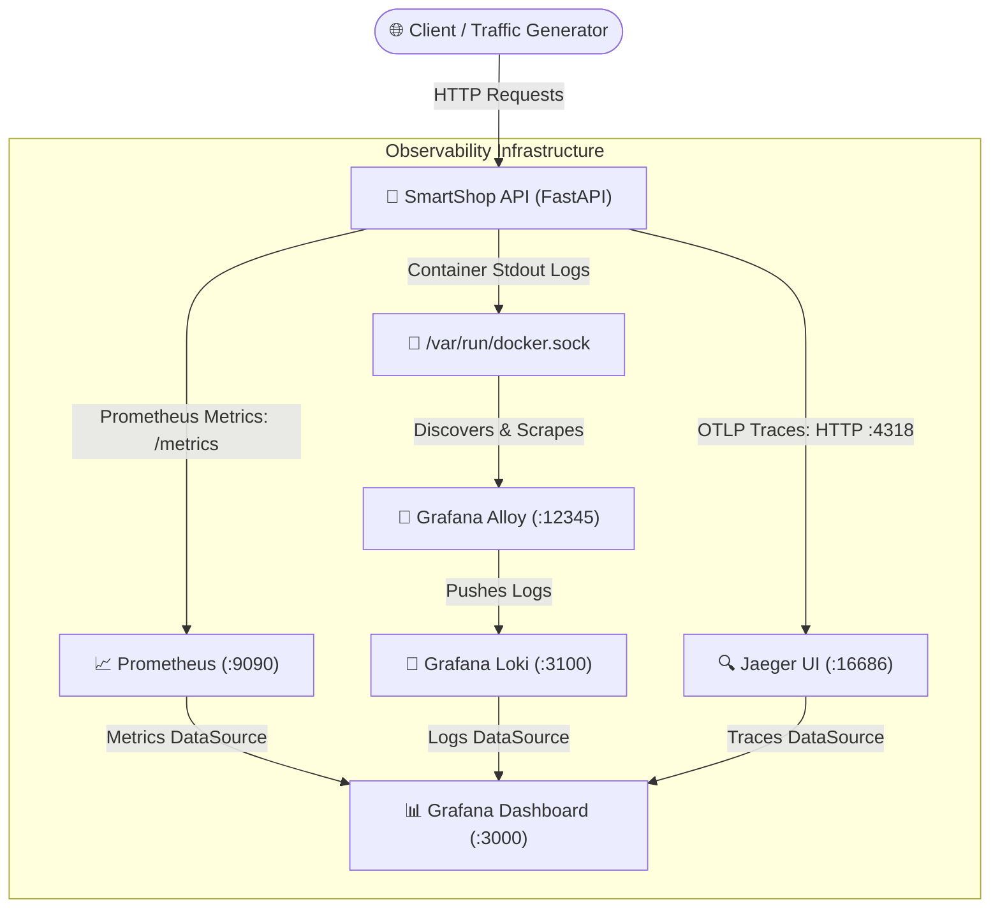

# 🔭 Complete Observability System

> **A production-grade, containerized observability platform implementing the Three Pillars of Observability—Metrics, Logs, and Distributed Traces—for a modern e-commerce microservice.**

[](https://www.python.org/)
[](https://fastapi.tiangolo.com/)
[](https://www.docker.com/)
[](https://prometheus.io/)
[](https://grafana.com/)
[](https://grafana.com/oss/loki/)
[](https://www.jaegertracing.io/)
[](https://opentelemetry.io/)

---

## 📑 Table of Contents
- [Architecture & Overview](#-architecture--overview)
- [The Three Pillars of Observability](#-the-three-pillars-of-observability)
- [Technology Stack](#️-technology-stack)
- [Port Mappings & Service Endpoints](#-port-mappings--service-endpoints)
- [Project Structure](#-project-structure)
- [Quick Start Guide](#-quick-start-guide)
- [Simulating Traffic & Observability Signals](#-simulating-traffic--observability-signals)
- [Key Features & Implementation Details](#-key-features--implementation-details)
- [Evaluation & Verification Checklist](#-evaluation--verification-checklist)

---

## 🚀 Architecture & Overview

This project simulates a production e-commerce backend service (**SmartShop API**) monitored by an end-to-end, unified telemetry infrastructure. All services are orchestrated using Docker Compose with dedicated storage volumes and automated network discovery.



---

## 🏛️ The Three Pillars of Observability

### 1. 📈 Metrics (Prometheus)
- **Scrape Target:** Real-time polling of SmartShop API's `/metrics` endpoint.
- **Instrumented Telemetry:**
  - `http_requests`: Total request count partitioned by `method`, `endpoint`, and `status_code`.
  - `http_request_duration_seconds`: Histogram measuring response latency distributions and percentiles (p50, p90, p99).
  - `http_requests_in_progress`: Gauge reflecting active in-flight HTTP requests.

### 2. 📜 Centralized Logging (Grafana Alloy + Loki)
- **Log Collection:** **Grafana Alloy** dynamically discovers running containers via `/var/run/docker.sock`.
- **Relabeling & Shipping:** Extracts container metadata, formats structured labels, and ships stdout/stderr streams to **Grafana Loki**.
- **Querying:** Instant search, filtering, and LogQL streaming inside Grafana.

### 3. 🔍 Distributed Tracing (OpenTelemetry + Jaeger)
- **FastAPI Auto-Instrumentation:** Automatic span generation for all incoming HTTP requests.
- **Custom Application Spans:** In-depth tracing inside business logic:
  - `products.fetch`: Tracks database/product lookups.
  - `orders.process`: Root span tracking end-to-end checkout transactions.
  - `orders.find_product`: Child span measuring product catalog lookup and validation.
  - `orders.calculate_total`: Child span measuring price calculations.
  - `request.slow_simulation`: Diagnostic span identifying high-latency execution bottlenecks.
- **OTLP Exporter:** Asynchronously batches and exports spans over OpenTelemetry Protocol (`OTLP/HTTP`) to Jaeger.

---

## 🛠️ Technology Stack

| Layer | Technology | Purpose |
| :--- | :--- | :--- |
| **Backend API** | Python 3.12, FastAPI, Uvicorn | High-performance asynchronous REST API |
| **Instrumentation** | OpenTelemetry SDK, Prometheus Client | Generating metrics, spans, and structured logs |
| **Metrics Engine** | Prometheus v3.5.0 | Time-series metrics collection and querying |
| **Log Collector** | Grafana Alloy | Cloud-native telemetry collector & log forwarder |
| **Log Aggregator** | Grafana Loki v3.7.0 | Log storage and indexing system |
| **Distributed Tracing** | Jaeger | End-to-end distributed trace storage and UI |
| **Visualization** | Grafana | Unified observability dashboards and analytics |
| **Orchestration** | Docker & Docker Compose | Containerized service management and isolation |

---

## 📊 Port Mappings & Service Endpoints

| Service | Host URL / Port | Container Port | Purpose |
| :--- | :--- | :--- | :--- |
| 🛒 **SmartShop API** | [http://localhost:8000](http://localhost:8000) | `8000/tcp` | Core e-commerce REST application |
| 📊 **Grafana** | [http://localhost:3000](http://localhost:3000) | `3000/tcp` | Dashboards (`admin` / `admin`) |
| 📈 **Prometheus** | [http://localhost:9090](http://localhost:9090) | `9090/tcp` | Metrics engine and PromQL console |
| 🔍 **Jaeger UI** | [http://localhost:16686](http://localhost:16686) | `16686/tcp` | Distributed tracing search and visualizer |
| 🔄 **Grafana Alloy** | [http://localhost:12345](http://localhost:12345) | `12345/tcp` | Log scraper health & pipeline debugging |
| 📜 **Loki** | [http://localhost:3100](http://localhost:3100) | `3100/tcp` | Log ingestion and query API |

---

## 📁 Project Structure

```text
complete-observability-system/
├── docker-compose.yml       # Multi-service stack definition
├── app/
│   ├── Dockerfile           # Python 3.12 container specification
│   ├── requirements.txt     # FastAPI, Prometheus & OpenTelemetry dependencies
│   └── main.py              # Application logic, endpoints & instrumentation
├── alloy/
│   └── config.alloy         # Docker container discovery & Loki forwarding
├── loki/
│   └── loki-config.yaml     # Loki storage, schema & ingestion settings
├── prometheus/
│   └── prometheus.yml       # Scrape configs & evaluation intervals
└── README.md                # Project documentation
```

---

## 🚀 Quick Start Guide

### 1. Prerequisites
- [Docker](https://docs.docker.com/get-docker/) installed and running.
- [Docker Compose](https://docs.docker.com/compose/) v2 or higher.

### 2. Clone the Repository
```bash
git clone https://github.com/YOUR_GITHUB_USERNAME/complete-observability-system.git
cd complete-observability-system
```

### 3. Launch the Observability Stack
Spin up all microservices and telemetry containers in detached mode:
```bash
docker compose up -d --build
```

### 4. Verify Service Health
Check that all containers are active:
```bash
docker compose ps
```

You should see all 6 services (`smartshop-api`, `prometheus`, `loki`, `alloy`, `jaeger`, `grafana`) in an `Up` status.

---

## 🧪 Simulating Traffic & Observability Signals

Generate real transactions and error traces by sending test requests to the API:

```bash
# 1. Health check & Home
curl -s http://localhost:8000/
curl -s http://localhost:8000/health

# 2. Retrieve product catalog (generates 'products.fetch' trace span)
curl -s http://localhost:8000/products

# 3. Create successful order (generates nested 'orders.process' traces)
curl -s -X POST http://localhost:8000/orders \
  -H "Content-Type: application/json" \
  -d '{"product_id": 1, "quantity": 2}'

# 4. Trigger 404 Not Found error span
curl -s -X POST http://localhost:8000/orders \
  -H "Content-Type: application/json" \
  -d '{"product_id": 999, "quantity": 1}'

# 5. Simulate 5-second slow request (identifies latency bottlenecks)
curl -s http://localhost:8000/slow

# 6. Simulate 500 Internal Server Error (triggers error status in Jaeger & Prometheus)
curl -s http://localhost:8000/error
```

---

## 🎯 Key Features & Implementation Details

- **Live Code Reloading via Bind Mounts:**  
  The `./app:/app` directory is mounted into the container, allowing hot modifications without rebuilding images during development.
- **Granular Custom Spans:**  
  Business logic breaks down order processing into distinct operations (`find_product`, `calculate_total`) with custom attributes like `order.total_price`, `order.product_id`, and `order.quantity`.
- **Zero-Friction Log Relabeling:**  
  Grafana Alloy automatically strips container ID prefixes and exposes human-readable `{container="smartshop-api"}` labels for LogQL queries.
- **Unified Grafana Integration:**  
  Grafana connects Prometheus, Loki, and Jaeger datasources in one place, allowing drill-down from a metric alert directly to logs and corresponding trace IDs.

---

## 🌟 Evaluation & Verification Checklist

- [x] **SmartShop API:** Exposing valid metrics on `/metrics`.
- [x] **Prometheus:** Successfully scraping target `smartshop-api:8000` with state `UP`.
- [x] **Grafana Alloy:** Discovering Docker container socket and streaming logs.
- [x] **Loki:** Ingesting formatted application and access logs.
- [x] **Jaeger:** Receiving OTLP HTTP spans on port `4318` and indexing service `smartshop-api`.
- [x] **Grafana:** Visualizing metrics, logs, and traces in unified dashboards.

